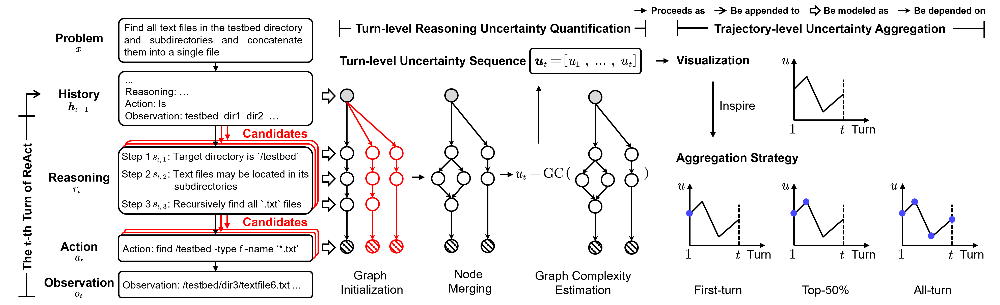

# GRUET

Code for **GRUET: Quantifying Uncertainty of Agentic Reasoning-and-Acting Processes**.

Shuang Liang, Xin-Yu Hu, and Shao-Qun Zhang · [Paper](https://arxiv.org/abs/2609.24831)

GRUET (Graph-based Reasoning UncErtainty in Trajectories) represents sampled reasoning chains as graphs and merges semantically equivalent steps and actions. It combines token uncertainty with graph structure to score each turn, then aggregates these scores to estimate uncertainty across an agent's reasoning-and-acting trajectory.



## Getting Started

```bash
git clone https://github.com/Mark-Liangs/GRUET.git
cd GRUET
```

Use Python 3.11.14, Conda, NVIDIA GPUs, and a running Docker daemon. Run all commands from the repository root.

```bash
bash setup.sh
```

The pinned dependencies include PyTorch 2.10.0, vLLM 0.19.0, Transformers 4.57.6 for Qwen or 5.5.4 for Gemma, and Hydra 1.3.2. The paper experiments used four NVIDIA A100 GPUs (80 GB each); the supplied SWE model profiles use two-way tensor parallelism.

### Models and Data

Obtain access to the source models below, including approval for gated Gemma weights, and authenticate with `hf auth login` when needed. Model paths, tokenizer paths, and tensor parallelism are configured in `src/agent_uq/conf/release/models.yaml`. Scoring also downloads `Salesforce/SFR-Embedding-Code-2B_R`, `microsoft/deberta-large-mnli`, and `cross-encoder/stsb-roberta-large`; reasoning contenders download pinned `Qwen/Qwen3.5-9B` and `bert-base-uncased` snapshots configured in `src/agent_uq/conf/release/reasoning.yaml`. Supported model IDs are:

| Family | Hugging Face model ID |
| --- | --- |
| Qwen3.5 | `Qwen/Qwen3.5-2B`, `Qwen/Qwen3.5-4B`, `Qwen/Qwen3.5-9B`, `Qwen/Qwen3.5-27B`, `Qwen/Qwen3.5-35B-A3B` |
| Gemma4 | `google/gemma-4-E2B-it`, `google/gemma-4-E4B-it`, `google/gemma-4-26B-A4B-it`, `google/gemma-4-31B-it` |

We use five datasets: InterCode MBPP, Spider, and NL2Bash fs1, plus SWE-bench Lite and Verified. InterCode data are included under `vendor/intercode/data/`; the SWE workflow downloads the selected SWE-bench dataset and uses the bundled SWE-agent tools and demonstration.

## Running Experiments

The entry point is `python -m agent_uq.release.runner`. It generates trajectories, scores fourteen uncertainty methods, and evaluates mean-trajectory AUROC. Runs are listed in `src/agent_uq/conf/release/experiments.yaml`; all runs share `src/agent_uq/conf/estimator/gut_up.yaml`, while generation settings are in `src/agent_uq/conf/intercode_run/` and `src/agent_uq/conf/swe_run/`.

### Paper Experiments

Run the configured 23 model/dataset combinations across nine models and five datasets:

```bash
conda run --no-capture-output -n gruet python -m agent_uq.release.runner --run all --output-root output/main
```

The runner executes these jobs sequentially and selects `gruet` or `gruet-gemma` for each model.

## Configuration Parameters

| Parameter | Default | Description |
| --- | --- | --- |
| `--run` | Required | Run ID from `release/experiments.yaml`, or `all`. |
| `--output-root` | Required | Root directory for trajectories, scores, and evaluation tables. |
| `--models` | `release/models.yaml` | YAML overrides for source model and tokenizer paths, tensor parallelism, and GPU memory utilization. |
| `--estimator-config` | `gut_up` | Shared GRUET scoring profile. |
| `--max-records` | Run configuration | Override the number of dataset records used by each selected run. |

## Outputs

Runs save outputs under the selected output root:

```text
<output-root>/
  protocol.json
  <run-id>/
    raw/
    scored/
    reasoning/
    results/auroc.{csv,json}
  results/auroc.{csv,json}
```

`AUROC` is higher-is-better. Each evaluation row identifies the run, model, dataset, estimator, and mean aggregator, and includes `n_total`, `n_valid`, `n_excluded`, and `status`.

The GRUET method identifier is `gut_up`. Per-run evaluation tables are also written under `<run-id>/results/`; SWE raw and scored records are under each run's resolved `import/` leaf.

## Citation

If you find this work helpful, please cite as

```bibtex
@article{liang2026gruet,
  author  = {Shuang Liang and
             Xin{-}Yu Hu and
             Shao{-}Qun Zhang},
  title   = {{GRUET}: Quantifying Uncertainty of Agentic
             Reasoning-and-Acting Processes},
  journal = {arXiv preprint arXiv:2609.24831},
  year    = {2026}
}
```
